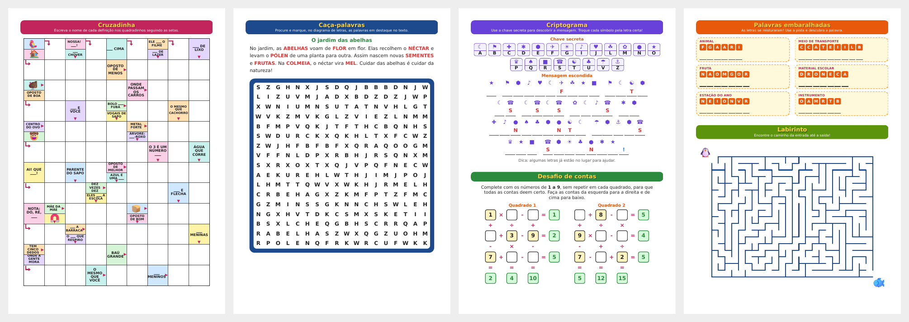

# Passatempos Infantis para o Claude

> 🇺🇸 *A Claude skill that generates kids' activity sheets (crossword, word search, cryptogram, math square, scrambled words and maze) as printable A4 PDFs, with the answers in a separate file. Docs in Portuguese.*

Uma **skill do Claude** que gera **passatempos infantis prontos para imprimir**, no estilo das revistinhas de passatempo: cruzadinha de grade cheia, caça-palavras, criptograma, desafio de contas, palavras embaralhadas e labirinto. Saem dois PDFs A4, um com os jogos e outro com as respostas.

## Destaques

- **Cruzadinha de grade cheia**, como a das revistinhas: sem casas vazias, com as dicas (figuras ou texto) dentro da grade, setas retas e dobradas e casas com duas dicas. As palavras vêm de um [dicionário infantil](dicionario/) com cerca de 4.650 palavras separadas por nível.
- **5 níveis de dificuldade**, do 1º ano ao 7º ano em diante, com regras por nível: tamanho da grade e das palavras, tipos de dica e direções do caça-palavras.
- **Não repete conteúdo:** guarda um histórico das palavras, temas e curiosidades já usados (na memória do Claude, quando disponível) e evita repeti-los nas próximas gerações.
- **Economiza papel:** jogos menores dividem a mesma folha, e o gerador mede a altura real de cada um para decidir.
- **Respostas conferíveis:** o gerador imprime um relatório (palavras colocadas, erros de encaixe) que o Claude usa para corrigir antes de entregar.
- **Modo automático:** basta pedir "faz uns passatempos". Detalhes como "nível 3", "só caça-palavras" ou "tema dinossauros" também funcionam.

## Exemplo

Na pasta [`examples/`](examples/):
- [`passatempos-exemplo.pdf`](examples/passatempos-exemplo.pdf): as 4 folhas de jogos, nível 2
- [`passatempos-exemplo_respostas.pdf`](examples/passatempos-exemplo_respostas.pdf): as respostas
- [`entrada-exemplo.json`](examples/entrada-exemplo.json): a entrada que gerou o exemplo
- [`grade-exemplo.json`](examples/grade-exemplo.json): a grade da cruzadinha montada na etapa 1

## Instalação

**claude.ai:** compacte a pasta `skill/passatempos-infantis` em um `.zip` e envie na área de Skills das configurações.

**Claude Code:** copie a pasta `skill/passatempos-infantis` para `~/.claude/skills/passatempos-infantis`.

Para a cruzadinha, adicione o arquivo [`dicionario/palavras_cruzadinha.tsv`](dicionario/palavras_cruzadinha.tsv) como documento do Projeto do claude.ai onde a skill roda.

O ambiente de execução precisa de **Python 3**, **git** e **Google Chrome ou Chromium** (usado para gerar o PDF). Na primeira execução, a skill baixa as ilustrações do Fluent Emoji.

## Como funciona

1. O Claude escolhe o nível, os jogos e o tema.
2. **Cruzadinha, etapa 1:** o gerador sorteia o desenho da grade e a preenche com palavras do dicionário, começando sempre pela palavra com menos opções. Ele testa centenas de grades e fica com a que tem mais palavras do nível pedido.
3. **Cruzadinha, etapa 2:** o Claude escreve uma dica para cada palavra escolhida, com figura (o desenho é a resposta) ou texto curto.
4. O Claude escreve um `entrada.json` com as dicas da cruzadinha e o conteúdo dos outros jogos. O gerador em Python (o código está dentro do `SKILL.md`) monta tudo e renderiza em HTML.
5. O Chrome em modo headless converte o HTML em dois PDFs A4.
6. O Claude confere o relatório, corrige o que for preciso e registra no histórico o que foi usado.

## Créditos

Ilustrações: [Fluent Emoji](https://github.com/microsoft/fluentui-emoji), da Microsoft, sob licença MIT. Elas são baixadas na hora e não ficam neste repositório.

Dicionário da cruzadinha: derivado do [LexPorBR Infantil](https://lexicodoportugues.com/infantil/), sob licença CC BY-NC-SA 4.0 (detalhes em [`dicionario/`](dicionario/)).

## Licença

Código e documentação: [MIT](LICENSE). Dicionário: CC BY-NC-SA 4.0. Feito por [Eudes Junior](https://www.linkedin.com/in/eudescj), Analista de Dados.
